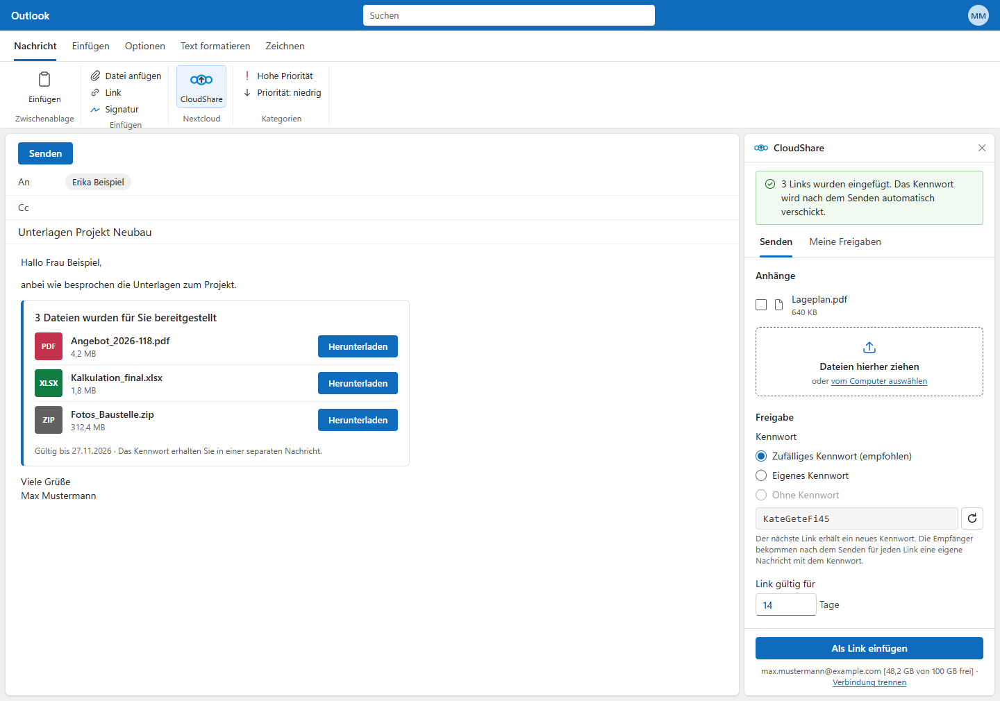
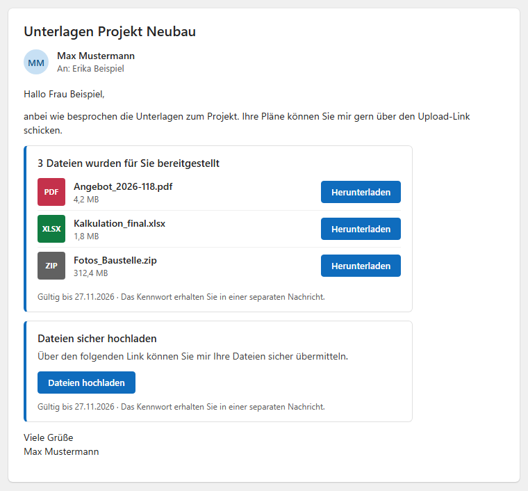
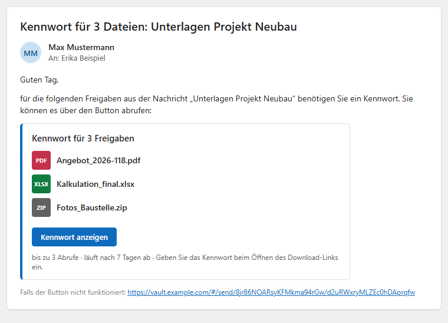
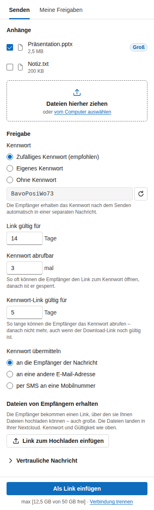
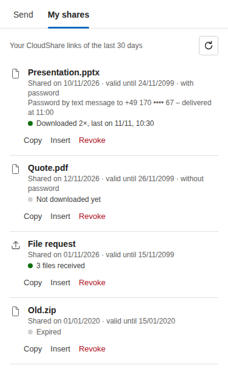
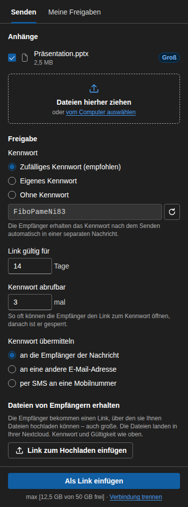
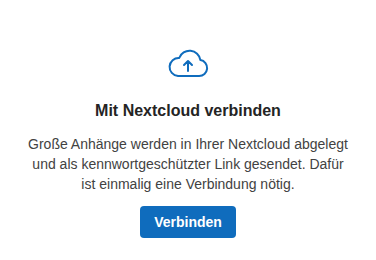

# CloudShare

**Send large files from Outlook as password-protected Nextcloud links – with the password delivered automatically in
a second mail.**

CloudShare is an Outlook add-in for Microsoft 365 / Exchange Online (classic Outlook on Windows, new Outlook and
Outlook on the web). Instead of attaching a large file, the sender clicks **"Als Link einfügen"**: the file is
uploaded to the sender's own Nextcloud and a download card is inserted into the mail. As soon as the mail has really
been sent, the recipients get a second mail with a link to the password (a Vaultwarden Send that can only be opened a
limited number of times).



*All pictures use example data (Max Mustermann, example.com) and show the German interface (`LANGUAGE=de`, the
default). English is included and further languages can be added – see [Languages](#languages). Labels quoted in this
README are the German ones.*

## Contents

- [What recipients see](#what-recipients-see)
- [Using CloudShare](#using-cloudshare)
- [How it works](#how-it-works)
- [Installation](#installation)
- [Configuration](#configuration)
- [Languages](#languages)
- [Operation](#operation)
- [Troubleshooting](#troubleshooting)
- [Development and tests](#development-and-tests)

## What recipients see

| 1. The mail with the download links | 2. Shortly after: the password |
|---|---|
|  |  |
| One card per "Als Link einfügen": file type, name, size and a download button; optionally a link through which the recipients can upload files themselves. | One password mail per card. "Kennwort anzeigen" opens the Vaultwarden Send; it works only a few times (default 3) and expires after 7 days. |

The password never travels in the same mail as the link, and it is only sent once the mail with the link has really
left the outbox.

## Using CloudShare



**Once:** open the pane with the **CloudShare** button in the ribbon and click **"Verbinden"** – the Nextcloud login
opens in the browser (usually without typing anything, thanks to single sign-on). CloudShare remembers the
connection.

**Sending files:**

1. Attach the file as usual, or drag files from Explorer onto the drop zone **"Dateien hierher ziehen"** in the pane (or
   click it to choose files). Attachments above the threshold (default 1 MB) are marked **"Groß"** and preselected;
   Outlook also shows a hint above the mail.
2. Choose the password:
   - **Zufälliges Kennwort** (default) – easy to read out, e.g. `KateGeteFi45`.
   - **Eigenes Kennwort** – at least 12 characters, three of four character types.
   - **Ohne Kennwort** – only if your Nextcloud allows links without a password.
3. Optionally adjust **"Link gültig für"** (days), **"Kennwort abrufbar"** (how often the password link opens) and
   **"Kennwort übermitteln"**: to the recipients of the mail (default), only to **another e-mail address** (e.g. a
   colleague), or **per SMS** to a mobile number (if SMS is set up – the password arrives as plain text, sent after
   the mail).
4. Click **"Als Link einfügen"**. The attachment is replaced by a download card in the mail.
5. Send the mail. CloudShare sends the password mail (or SMS) on its own. "Meine Freigaben" later shows how the
   password went out, for SMS with the delivery status. With the download confirmation switched on, you get a mail
   when a recipient downloads a file for the first time.

Every click on "Als Link einfügen" gets **its own password and its own password mail**; files selected together in
one click share them. If you delete all CloudShare cards from the mail before sending, no password mail goes out
and the password options are free again.

**Receiving files:** **"Link zum Hochladen einfügen"** inserts a link through which the recipients can upload files –
also very large ones – straight into your Nextcloud (folder `Outlook-Dateianforderungen`).

<br clear="right">



**"Meine Freigaben"** lists your CloudShare links of the last 30 days: when they were shared, until when they are
valid, whether they have a password, and how often they were downloaded (or how many files were received).

- **Kopieren** – copies the link.
- **Einfügen** – inserts the file again into the mail you are writing, as a *new* link with a new password.
- **Zurückziehen** – ends the link at once (two clicks). The file then counts as expired and is moved to your
  Nextcloud trash.

Expired files are cleaned up automatically as well (see `CLEANUP_AFTER_DAYS`).

<br clear="right">




The pane follows Outlook's light or dark theme and uses Outlook's own wording ("Nachricht", "Kennwort"; in English
"message", "password").

Under the attachment policy **`enforce`** (default), large attachments can only be sent through CloudShare; under
**`suggest`** Outlook asks once when sending and offers **"Trotzdem senden"**.

<br clear="right">

## How it works

```
Outlook add-in ──HTTPS──► Caddy (Let's Encrypt) ──► CloudShare container
                                                      ├─ upload + link ──────► the sender's Nextcloud
                                                      ├─ password link ──────► Vaultwarden (Send)
                                                      └─ password mail ──────► Microsoft Graph (as the sender)
```

- The add-in signs in with the user's Microsoft 365 account (Office single sign-on) – no extra password.
- Files go to the **sender's own Nextcloud** (`CloudShare/<date>_<id>/`) using a Nextcloud app password the user
  granted once; CloudShare stores it encrypted.
- The password mail is sent **as the sender** via Microsoft Graph, only after the mail appears in "Gesendete
  Elemente" – also for shared mailboxes.
- All texts come from a language file (`locales/de.json`, `locales/en.json`, …), chosen with `LANGUAGE`.
- One Docker container plus Caddy, no database. Details, data flows and design decisions:
  **[docs/architecture.md](docs/architecture.md)**.

## Installation

### Requirements

- Microsoft 365 / Exchange Online and permission to register an app in Entra ID and deploy add-ins
- Nextcloud with public links enabled (any login method – users connect once via Login Flow v2)
- Vaultwarden with Sends enabled and a service account for CloudShare
- A Docker host with Docker Compose ≥ 2.20, a public DNS name and ports 80/443 reachable from the internet

The examples use `cloudshare.example.com` (CloudShare), `cloud.example.com` (Nextcloud) and `vault.example.com`
(Vaultwarden).

### 1. Entra ID, Nextcloud, Vaultwarden

- **Microsoft 365:** register the app "CloudShare" in Entra ID (application ID URI, scope `access_as_user`, Office as
  authorized client, Graph permissions with admin consent, client secret) – step by step in
  **[docs/microsoft-365.md](docs/microsoft-365.md)**, including Exchange settings, checks and an error table.
- **Nextcloud and Vaultwarden:** allow public links in Nextcloud and create the Vaultwarden service account –
  [docs/architecture.md → Setup](docs/architecture.md#7-setup).

### 2. Install on the Docker host

```bash
git clone https://github.com/mrprohl/CloudShare.git /opt/cloudshare
cd /opt/cloudshare && ./setup.sh          # asks for address, language, Entra ID, Nextcloud, Vaultwarden; writes env/
grep CREDENTIAL_KEY env/cloudshare.env    # store this key in your password manager
```

- **DNS:** `cloudshare.example.com` → the Docker host; open ports 80 and 443 (443 also UDP for HTTP/3). Caddy fetches
  the certificate on the first start.
- **Start:** Portainer/Dockhand stack "cloudshare" with the contents of `/opt/cloudshare/docker-compose.yml`, or
  `cd /opt/cloudshare && docker compose up -d`.

The image `ghcr.io/mrprohl/cloudshare` is built by GitHub – nothing is compiled on the server.

### 3. Deploy the add-in

Microsoft 365 admin center → *Settings → Integrated apps → Upload custom apps* → manifest URL
`https://cloudshare.example.com/manifest.xml`. Start with your own account, then roll out. It can take up to 24 hours
until Outlook shows the button. Details and how to check the result:
[docs/microsoft-365.md → Deploying the add-in](docs/microsoft-365.md#3-deploying-the-add-in).

Alternative with a clearer error message (Exchange Online PowerShell):
`New-App -OrganizationApp -Url https://cloudshare.example.com/manifest.xml -ProvidedTo Everyone -DefaultStateForUser Enabled`

**Already running a reverse proxy?** Remove the `caddy` service and its `ports:` from `compose.yml`, put `cloudshare`
into the proxy's network and forward the host name to `cloudshare:3000` with the settings from `caddy/Caddyfile`
(request body ≥ 12 MB, no `X-Frame-Options` – Outlook shows the pane in a frame).

## Configuration

All settings live in `env/cloudshare.env` (written by `setup.sh`, reference: `cloudshare.env.example`). After a
change: update the stack (Portainer "Update the stack" or `docker compose up -d`) – the add-in does not have to be
deployed again.

| Setting | Default | Meaning |
|---|---|---|
| `PUBLIC_BASE_URL` | – | Public address of CloudShare, e.g. `https://cloudshare.example.com` |
| `LANGUAGE` | `de` | Language of the taskpane, Outlook messages, link cards, password mail, SMS and download confirmation: `de`, `en` or an own one, see [Languages](#languages) |
| `ENTRA_TENANT_ID`, `ENTRA_CLIENT_ID`, `ENTRA_CLIENT_SECRET` | – | Entra ID app registration |
| `NEXTCLOUD_URL` | – | Public address of Nextcloud |
| `NEXTCLOUD_FOLDER` | `CloudShare` | Folder for uploaded files in each user's Nextcloud |
| `NEXTCLOUD_REQUEST_FOLDER` | `Outlook-Dateianforderungen` | Folder for files received through upload links |
| `CREDENTIAL_KEY` | – | Key for the stored Nextcloud app passwords (`openssl rand -base64 32`); changing it disconnects all users |
| `ATTACHMENT_THRESHOLD_MB` | `1` | From this size CloudShare steps in (hint while writing, check on send) |
| `ATTACHMENT_POLICY` | `enforce` | `enforce`: large attachments only via CloudShare · `suggest`: ask once, "Trotzdem senden" possible |
| `SHARE_EXPIRE_DAYS` / `SHARE_MAX_EXPIRE_DAYS` | `14` / `90` | Link validity: default / maximum |
| `SEND_MAX_ACCESS_COUNT` / `SEND_MAX_ACCESS_LIMIT` | `3` / `20` | How often the password link opens: default / maximum |
| `SEND_EXPIRE_DAYS` | `7` | Lifetime of the password link |
| `SEVEN_API_KEY`, `SEVEN_SENDER`, `SEVEN_WEBHOOK_SECRET` | – | Password by SMS via seven.io; without a key the option is not offered. Delivery reports: callback URL `https://<host>/webhooks/seven?token=<secret>` in the seven.io dashboard |
| `SMS_DEFAULT_COUNTRY` / `SMS_MAX_PER_DAY` | `49` / `50` | Country code for numbers like `0170 …` / SMS per user and day |
| `DOWNLOAD_NOTICE` | off | `true`: mail to the sender on the first download (needs the Entra application permission `Mail.Send`, see architecture) |
| `CLEANUP_AFTER_DAYS` | `0` | Uploaded files go to the Nextcloud trash this many days after their link expired or was revoked; `off` = never. Received files are never deleted |
| `MAIL_FOOTER` | empty | Optional footer line in the card, e.g. `'{displayName} · {jobTitle}\n{company}'` (filled from the sender's profile) |
| `VAULTWARDEN_URL`, `BW_CLIENTID`, `BW_CLIENTSECRET`, `BW_PASSWORD` | – | Vaultwarden service account |
| `RATE_LIMIT_PER_MINUTE` | `600` | Requests per minute and user |
| `CLIENT_TRACE` | off | Diagnostics, see [Troubleshooting](#troubleshooting) |

`env/versions.env` holds `CLOUDSHARE_HOST`, `CLOUDSHARE_VERSION` (`latest`) and `CADDY_VERSION`.

**Text templates** (optional): the SMS text, the subject and intro of the password mail and the download confirmation
can be changed in `env/config/templates.json` – one default plus overrides per department (from the sender's
Microsoft 365 profile) and per sender address. Start from [`templates.example.json`](templates.example.json):

```bash
mkdir -p /opt/cloudshare/env/config
cp /opt/cloudshare/templates.example.json /opt/cloudshare/env/config/templates.json
chmod 755 /opt/cloudshare/env/config && chmod 644 /opt/cloudshare/env/config/templates.json
```

Then update the stack. Mistakes (e.g. `{password}` in a mail text, an SMS without `{password}` or too long for one
SMS) are reported in the log at start; the affected text falls back to the built-in one.
The built-in texts are those of the configured language (section `templates` of its language file).

## Languages

Everything users and recipients see – taskpane, info bar and send check in Outlook, the link card in the mail, the
password mail, the SMS, the download confirmation, error messages and the add-in's name and description in the
manifest – comes from one language file per language in [`locales/`](locales). `LANGUAGE` in `env/cloudshare.env`
picks it (`de` by default, `en` included):

```bash
LANGUAGE=en
```

Update the stack; CloudShare puts the texts into the add-in files when it starts. Outlook caches the add-in: clear the
cache in classic Outlook (see *Operation*), reload Outlook on the web. One language applies to all users of an
installation; recipients get the password mail and the SMS in the same language. Not affected by `LANGUAGE`:

- **Nextcloud folder names** – `NEXTCLOUD_REQUEST_FOLDER` stays as set (default `Outlook-Dateianforderungen`), so
  "Meine Freigaben" keeps finding older links. For an English installation set it in `setup.sh` / `env/cloudshare.env`
  before the first use, e.g. `Outlook file requests`.
- **`templates.json`** holds one set of texts – translate it as well, or remove it to use the built-in texts of the
  language.
- **`MAIL_FOOTER`** is written by the admin (e.g. `Tel.` vs. `Phone`).
- Outlook's own buttons (e.g. "Trotzdem senden" / "Send Anyway") follow the user's Outlook language.

**Adding a language** – copy [`locales/en.json`](locales/en.json) to `<code>.json` (e.g. `fr.json`) and translate the
values, keeping the keys and the `{placeholders}`. Keys ending in `_one` / `_other` are the singular and plural form.
`_meta.locale` (e.g. `fr-FR`) sets the date and number format and the manifest's `DefaultLocale`. Use Outlook's own
terms of that language, keep the SMS text (`templates.sms_template`) in the GSM alphabet (no accents beyond it, or the
SMS shrinks to 70 characters). Texts that are missing fall back to English. Two ways to use it:

- **Without a new image:** put the file into `/opt/cloudshare/env/config/locales/` (mounted read-only as
  `/config/locales`, directory `755`, file `644`), set `LANGUAGE=fr`, update the stack.
- **In the repository:** add it to `locales/` – the tests check that it has every text and placeholder of English and
  stays within Outlook's limits (e.g. the Smart Alert button `alert.button` at most 20 characters, the SMS text in
  the GSM alphabet with `{password}`); the image built from it contains the language.

The same directory also changes **single texts** of a built-in language: `env/config/locales/de.json` with only the
keys to change, e.g. `{ "addin": { "tabs.shares": "Freigaben" } }`. An unknown `LANGUAGE` stops the start with a
message listing the available languages (`docker logs cloudshare`).

## Operation

**Update:** Portainer → stack "cloudshare" → "Update the stack" with **re-pull** (or `docker compose pull && docker
compose up -d`). To pin a version: `CLOUDSHARE_VERSION=sha-<commit>` in `env/versions.env`. Changes to `compose.yml`
or the Caddyfile: `cd /opt/cloudshare && git pull`, then update the stack.

After an update, classic Outlook keeps its old copy of the add-in until its cache is cleared: close Outlook, delete
`%LOCALAPPDATA%\Microsoft\Office\16.0\Wef\`, start Outlook again.

**Back up** the volume `cloudshare_data` (encrypted Nextcloud app passwords, pending password mails, cleanup list, SMS status, download confirmations)
and `env/` (including `env/config/` with templates and own language files). Without `CREDENTIAL_KEY` the stored connections cannot be read – users would have to reconnect.

**Health check:**

```bash
docker ps --filter name=cloudshare                        # cloudshare "healthy", cloudshare-caddy "Up"
docker logs cloudshare 2>&1 | grep -i vault               # "Vaultwarden vault unlocked"
docker logs cloudshare 2>&1 | grep '"Language"'           # language and locale in use
curl -s https://cloudshare.example.com/api/config         # JSON with the settings shown to the add-in
```

**Repository layout on the server** (`/opt/cloudshare`): `docker-compose.yml` (stub for Portainer), `compose.yml`
(Caddy and CloudShare), `caddy/Caddyfile`, `setup.sh`, and `env/` (not in Git: `versions.env`, `cloudshare.env` with
the secrets, `config/` with the optional `templates.json` and own language files). The language files of the
repository (`locales/`) are part of the image and not needed on the server. Both containers run read-only without capabilities (Caddy only `NET_BIND_SERVICE`); only Caddy
publishes ports.

## Troubleshooting

| Symptom | Cause and fix |
|---|---|
| Outlook shows "CloudShare dauert länger als erwartet" when sending | Classic Outlook may run an old copy – clear the cache (see *Operation*). Otherwise switch on `CLIENT_TRACE=true`, send once and read the steps: `docker logs --since 5m cloudshare 2>&1 \| grep 'Smart Alert trace'`. The last step shown is where it stops. Switch it off again afterwards. |
| No password mail arrives | The password mail goes out only after the mail shows up in "Gesendete Elemente" (20–60 s). If saving sent items is switched off, no password mail is sent. Check `docker logs cloudshare 2>&1 \| grep "Password mail"`. |
| A click on the drop zone opens no dialog (classic Outlook) | Check with Alt+Tab whether the "Öffnen" dialog opened behind the Outlook window. Dragging files onto the pane always works. With `CLIENT_TRACE=true` every click is logged: `docker logs --since 5m cloudshare 2>&1 \| grep 'picker:'` shows whether the click arrived, which dialog was used and any error. |
| "Ohne Kennwort" is missing | Nextcloud enforces passwords for links (*Administration → Sharing*). Exempt a group there if some users may share without a password. |
| Sign-in error with a code (13xxx), `AADSTS…` in the log | The pane shows the Office SSO code and a hint; most often the Entra app registration (application ID URI, authorized client, admin consent, client secret) does not match. Error table: [docs/microsoft-365.md](docs/microsoft-365.md#8-errors-and-their-causes). |
| Nextcloud throttles CloudShare | All requests come from the server's address – allow it in Nextcloud's brute-force settings. |
| CloudShare does not start after setting `LANGUAGE` | The log names the problem and the available languages: `docker logs cloudshare 2>&1 \| grep LANGUAGE`. An own language needs `env/config/locales/<language>.json` (directory `755`, file `644`, valid JSON). |
| Outlook still shows the old language | Outlook caches the add-in: clear the cache in classic Outlook (see *Operation*), reload Outlook on the web. The ribbon label and description come from the manifest – Outlook may take up to 24 hours to pick it up. |
| A text shows a key like `tabs.send` | The text is missing in the own language file and in English – add it (keys: [`locales/en.json`](locales/en.json)). |

## Development and tests

```bash
cd server && npm install && npm test        # backend (Fastify, TypeScript)
cd addin  && npm install && npm test        # add-in (Office.js mock)
cd addin  && npx playwright install chromium && npm run test:ui   # taskpane in Chromium
```

**Texts** are never written into the code: the add-in uses `t("key")` (`addin/src/shared/i18n.ts`, section `addin`),
the server `t("section.key")` (`server/src/i18n.ts`), `taskpane.html` and `manifest.xml` use `%%t:section.key%%`. A new
text goes into every file in `locales/` with the same placeholders – the tests fail otherwise. Details:
[architecture → Languages](docs/architecture.md#28-languages).

Every push and pull request runs the pipeline in `.github/workflows/image.yml`:

| Stage | What is checked |
|---|---|
| test | type check and unit tests of both packages, **language files** (same texts and placeholders in every language, every key used exists, Outlook's length limits), `npm audit`, manifest validation per language, ShellCheck, deployment files (`setup.sh` with dummy answers, `docker compose config`, `caddy validate`) |
| ui | the real taskpane in Chromium with Office.js and the API mocked – upload, cards, passwords, "Meine Freigaben", dark theme, 320 px width and **accessibility** (axe, WCAG 2 A/AA); screenshots as artifact `ui-test-report` (the pane pictures in this README come from there) |
| build | image build, Trivy scan, **smoke test** of the real stack with Caddy (TLS, headers, add-in files with the texts of `LANGUAGE`, limits, hardening), **upgrade test** (data written by the published image must stay readable), **load test** (k6: 10 users × 2 × 45 MiB) |
| push | only if everything passed: `ghcr.io/mrprohl/cloudshare` (`latest`, `sha-<commit>`, version tags); pull requests publish nothing |

The repository also uses Dependabot, CodeQL and secret scanning with push protection (*Security* tab).

The compose and recipient pictures are rendered from [docs/mockups](docs/mockups) (they contain the exact markup the
add-in and the server produce – update them when the pane, the card or the password mail changes) with Edge, from the
repository root (absolute paths and an own profile, otherwise a running Edge swallows the screenshot):

```powershell
$edge = "C:\Program Files (x86)\Microsoft\Edge\Application\msedge.exe"
$repo = (Get-Location).Path; $url = "file:///" + ($repo -replace '\\','/') + "/docs/mockups"
$opts = "--headless=new", "--hide-scrollbars", "--user-data-dir=$env:TEMP\cloudshare-edge"
& $edge @opts --window-size=1440,1010 --screenshot="$repo\docs\images\outlook-compose.png" "$url/compose-send.html"
& $edge @opts --window-size=760,706  --screenshot="$repo\docs\images\mail-received.png"  "$url/mail-received.html"
& $edge @opts --window-size=760,548  --screenshot="$repo\docs\images\password-mail.png"  "$url/password-mail.html"
```

The pane pictures (`taskpane-*.png`) are screenshots of the UI tests (artifact `ui-test-report`: `send-light`,
`shares-light`, `send-dark`, `connect-view`), cropped to the content.
