# CloudShare

**Send large files from Outlook as password-protected Nextcloud links – with the password delivered automatically on
a separate way: in a second mail or by text message.**

CloudShare is an Outlook add-in for Microsoft 365 / Exchange Online (classic Outlook on Windows, new Outlook and
Outlook on the web). Instead of attaching a large file, the sender clicks **"Insert file as link"**: the file is
uploaded to the sender's own Nextcloud and a download card is inserted into the mail. As soon as the mail has really
been sent, the password goes out on its own – by default as a second mail to the recipients with a link to the
password (a Vaultwarden Send that can only be opened a limited number of times), or to another address, or as a
**text message** (SMS via seven.io, optional) straight to a phone. The same way the sender can insert a
**confidential message** (never part of the mail) or an **upload link** through which the recipients send files back.

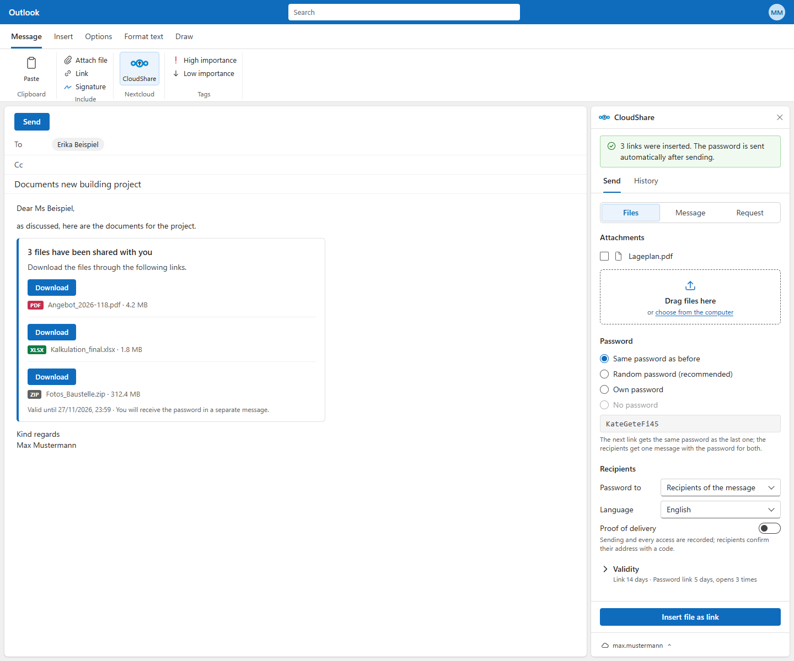

*All pictures use example data (Max Mustermann, example.com) and show the English interface (Outlook in English).
The add-in follows the Outlook language (German and English included, English otherwise), and further languages can
be added – see [Languages](#languages). Labels are quoted
as in the English interface; the German ones are in [`locales/de.json`](locales/de.json) – e.g. "Insert file as link"
is "Datei als Link einfügen", "My shares" is "Meine Freigaben".*

## Contents

- [What recipients see](#what-recipients-see)
- [What the sender gets](#what-the-sender-gets)
- [Using CloudShare](#using-cloudshare)
- [How it works](#how-it-works)
- [Installation](#installation)
- [Configuration](#configuration)
- [Languages](#languages)
- [Operation](#operation)
- [Troubleshooting](#troubleshooting)
- [Development and tests](#development-and-tests)

## What recipients see

| 1. The mail with the download links | 2. Shortly after: the password |
|---|---|
| 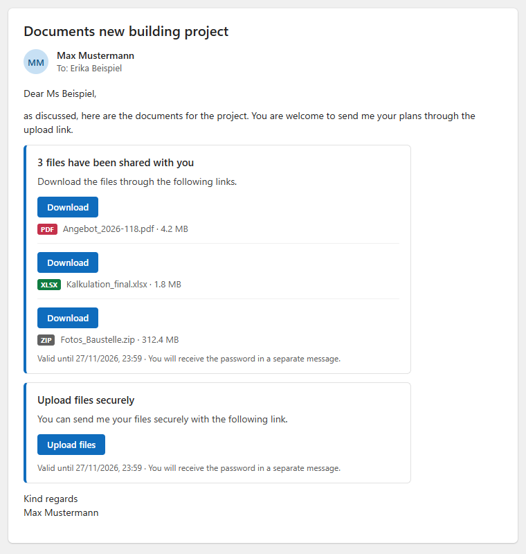 | 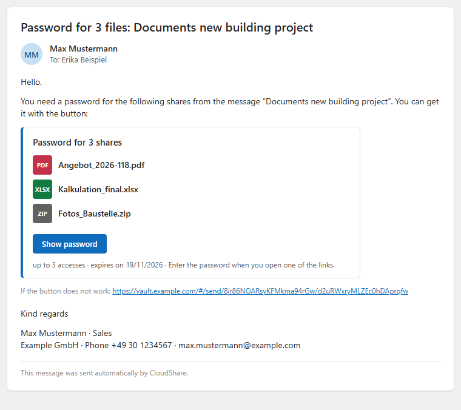 |
| One card per click on the insert button: file type, name, size and a download button; here also a link through which the recipients can upload files themselves (a confidential message gets its own card with "Open message"). | One password mail per card. "Show password" opens the Vaultwarden Send; it works only a few times (default 3) and for a few days (default 5, chosen by the sender). |

The password never travels in the same mail as the link, and it is only sent once the mail with the link has really
left the outbox.

## What the sender gets

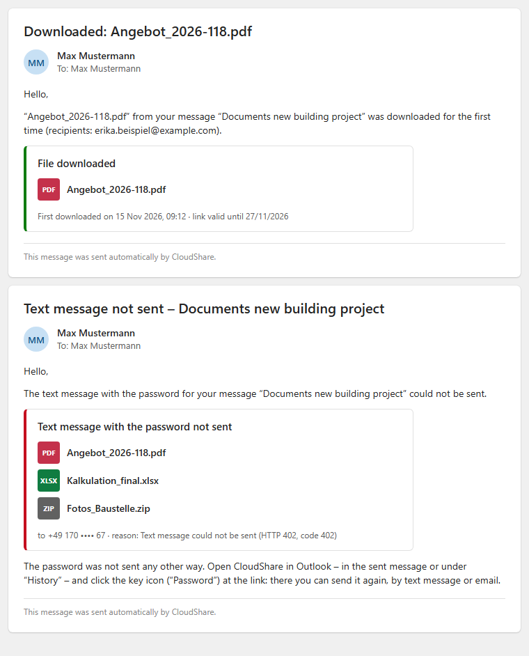

Every mail CloudShare sends on its own has **one layout**: a short text, one card like the link card in the mail
(title, files with their type, at most one button, a small line of details) and at the bottom the line **"This
message was sent automatically by CloudShare."** The colour of the card says what it is about: **blue** – the
password (to the recipients), **green** – downloaded, **red** – a problem.

- **Download confirmation** (only with `DOWNLOAD_NOTICE=true`): when a recipient downloads a file for the first time.
- **Files received** (only with `UPLOAD_NOTICE=true`): when files arrive through an upload link ("Request") – the
  new file names, a button to the folder in Nextcloud; checked every 10 minutes, so several uploads come as one mail.
- **Text message not sent / not delivered** (only with SMS; "not delivered", reported later by seven.io, only with
  `SMS_NOTICE=true`): the SMS with the password failed. The note contains neither the password nor a link to it –
  the password goes out no other way; send it again with **"Password"** (key icon) in "My shares".

<br clear="right">

## Using CloudShare

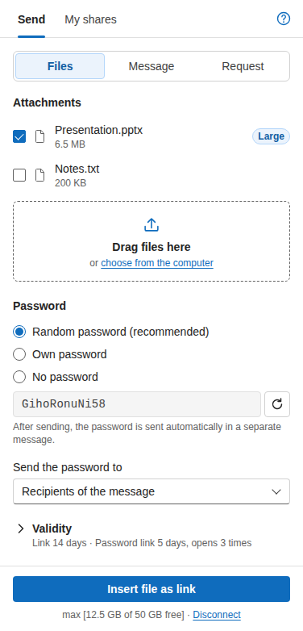

**Once:** open the pane with the **CloudShare** button in the ribbon and click **"Connect"** – the Nextcloud login
opens in the browser (usually without typing anything, thanks to single sign-on). CloudShare remembers the
connection.

At the top of the **"Send"** tab you choose **what** to insert: **Files**, a confidential **Message** or a **Request**
for files. The pane then shows only that, and the button at the bottom says what it inserts ("Insert 2 files as
links", "Insert confidential message", "Insert upload link"). Password, where it goes and validity below apply to all
three.

**Sending files** (**Files**):

1. Attach the file as usual, or drag files from Explorer onto the pane (or click the drop zone to choose files).
   Attachments above the threshold (default 5 MB) are marked **"Large"** and preselected; Outlook also shows a hint
   above the mail.
2. Choose the password:
   - **Random password** (default) – easy to read out, in varying patterns, e.g. `KateGeteFi45`, `47RantoBeKiwu`.
   - **Own password** – at least 12 characters, three of four character types.
   - **No password** – only for files and only if your Nextcloud allows links without a password. Anyone with the
     link can download the file while the link is valid; no password goes out, and that mail cannot get a
     confidential message or upload link any more (the pane says so).
3. **"Send the password to"**: the recipients of the mail (default), **another e-mail address** (e.g. a colleague),
   or a **phone number (SMS)** if SMS is set up – the password arrives as plain text, sent after the mail.
4. **"Validity"** is collapsed and shows its values in one line, e.g. "Link 14 days · Password link 5 days, opens 3
   times". Open it to change **"Link valid for"** (days the download link works – with a password at most 30, see below), **"Password can be opened"** (how
   often the password link opens) and **"Password link valid for"** (days the password can be fetched – default 5,
   at most 30). With SMS the two password-link settings disappear: the password is in the SMS itself and works as
   long as the link does.
5. Click **"Insert file as link"**. The attachment is replaced by a download card in the mail.
6. Send the mail. CloudShare sends the password mail (or SMS) on its own. "My shares" later shows how the
   password went out, for SMS with the delivery status. With the download confirmation switched on, you get a mail
   when a recipient downloads a file for the first time – also for links without password.

Every click on the button gets **its own password and its own password mail**; files selected together in one click
share them. If you delete all CloudShare cards from the mail before sending, no password mail goes out and the
password options are free again.

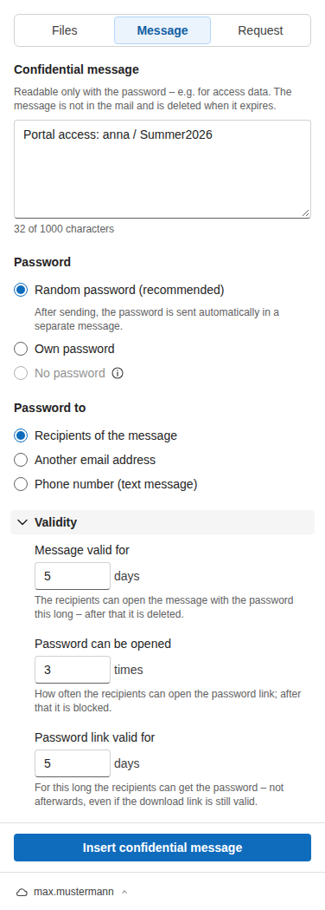

**Confidential message** (**Message**): type a message instead of choosing a file – e.g. access data – and click
**"Insert confidential message"**. The message does not go into the mail: it is stored encrypted in Vaultwarden as a Send
protected with the chosen password, and the mail gets a card with **"Open message"**. The password reaches the
recipients like for files. At most 1000 characters; under "Validity", **"Message valid for"** sets how long it can be
read (default 5 days, at most 30 – Vaultwarden's limit), then it is deleted.

**Receiving files** (**Request**): **"Insert upload link"** inserts a link through which the recipients can upload
files – also very large ones – straight into your Nextcloud (folder `CloudShare-File-Requests`).

Confidential messages and upload links always have a password, so "No password" is not offered there.

<br clear="right">

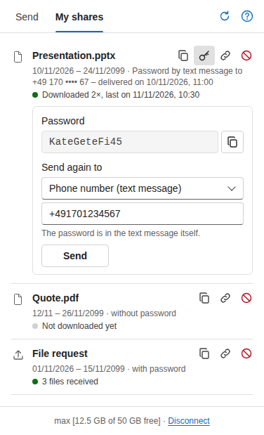

**"My shares"** lists all your valid CloudShare links, newest first – one short line each for the period
("10.11. – 24.11.2026"), the password (with / without, or how it went out: "Password by text message to … –
delivered") and the downloads (or received files). It loads when you open the tab and again when you come back to
the pane; **Refresh** (⟳ next to the "?") reloads it at any time. Expired links are not listed. At the bottom, as in
"Send": the Nextcloud account, its free space and "Disconnect". A link is created when it is inserted; until its mail has been sent it says
**"Not sent"**. If the mail is never sent (draft discarded), CloudShare revokes the link after 7 days.

The icons next to the name (their names show on hover and are explained in the help):

- **Copy** – copies the link.
- **Password** (key) – for links with password, until they expire: shows the password and sends it **again**, the same
  ways as the first time (preselected: the way it went then): to the **recipients of the message** – To, Cc and Bcc
  exactly as in the sent mail –, to **other addresses** (each gets a mail of its own, nobody sees the others) or by
  **SMS**. A mail again only contains a link to the password, never the password itself.
- **Insert** (chain) – inserts the file again into the mail you are writing, as a *new* link with a new password.
- **Revoke** (crossed-out circle) – ends the link at once (two clicks: the icon turns into "Sure?"). The file then
  counts as expired and is moved to your Nextcloud trash.

Expired files are cleaned up automatically as well (see `CLEANUP_AFTER_DAYS`).

<br clear="right">

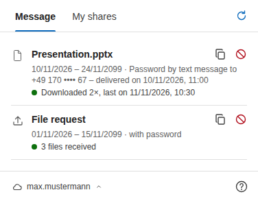

**Status of a sent mail:** the **CloudShare** button is also there while you **read** a mail – e.g. in *Sent Items*.
The pane then has the tabs **"Message"** (opened first, in place of "Send": the links of that mail – downloads,
how the password went out, validity) and **"My shares"** (all valid links, as when writing). **Pin** the pane (pin
icon in its header) and it follows the mail you select. Copy, Password and Revoke work as usual; nothing is inserted
there. Confidential messages are not listed (they are not stored in Nextcloud).

<br clear="right">

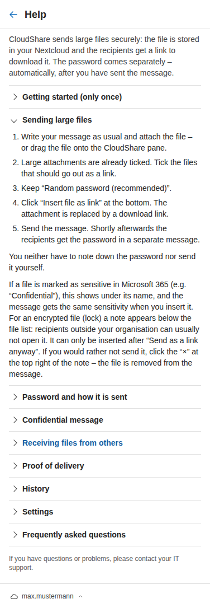

**Help for users:** the **question mark** at the top right of the pane opens a short guide ("Hilfe") written for
everyday users without IT knowledge – e.g. clerks in an administration: the first connection, sending large files
step by step, choosing the password and how it is sent (with a clear note that personal or confidential data always go
with a password), the confidential message, receiving files, "My shares" and frequently asked questions ("The
recipients did not get a password", "I sent the link to the wrong person" …). Short sections to open as needed; the
most common one is open. It opens in place of the current tab; "×", the question mark or a tab closes it again. It is
also there when the pane was opened from a sent mail. Its last sentence points to the IT support – put your own
contact there, see [Languages](#languages) (`help.support`).

<br clear="right">

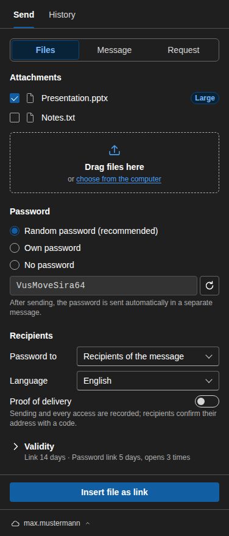
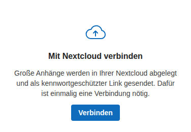

The pane follows Outlook's light or dark theme and uses Outlook's own wording ("message", "password"; in German
"Nachricht", "Kennwort").

Under the attachment policy **`suggest`** (default) Outlook asks once when sending large attachments and offers
**"Send Anyway"**; under **`enforce`** they can only be sent through CloudShare.

<br clear="right">

## How it works

```
Outlook add-in ──HTTPS──► Caddy (Let's Encrypt) ──► CloudShare container
                                                      ├─ upload + link ──────► the sender's Nextcloud
                                                      ├─ password link ──────► Vaultwarden (Send)
                                                      └─ password mail ──────► Microsoft Graph (as the sender)
```

- The add-in signs in with the user's Microsoft 365 account (Office single sign-on) – no extra password.
- Files go to the **sender's own Nextcloud** (`CloudShare/<date>_<id>/`) using a Nextcloud app password the user
  granted once; CloudShare stores it encrypted.
- The password mail is sent **as the sender** via Microsoft Graph, only after the mail appears in "Sent
  Items" – also for shared mailboxes.
- All texts come from a language file (`locales/de.json`, `locales/en.json`, …): the add-in follows the Outlook language (English if there is no file for it), mails and SMS use `LANGUAGE`.
- One Docker container plus Caddy, no database. Details, data flows and design decisions:
  **[docs/architecture.md](docs/architecture.md)**.

## Installation

### Requirements

- Microsoft 365 / Exchange Online and permission to register an app in Entra ID and deploy add-ins
- Nextcloud with public links enabled (any login method – users connect once via Login Flow v2)
- Vaultwarden with Sends enabled and a service account for CloudShare
- A Docker host with Docker Compose ≥ 2.20, a public DNS name and ports 80/443 reachable from the internet

The examples use `cloudshare.example.com` (CloudShare), `cloud.example.com` (Nextcloud) and `vault.example.com`
(Vaultwarden).

### 1. Entra ID, Nextcloud, Vaultwarden

- **Microsoft 365:** register the app "CloudShare" in Entra ID (application ID URI, scope `access_as_user`, Office as
  authorized client, Graph permissions with admin consent, client secret) – step by step in
  **[docs/microsoft-365.md](docs/microsoft-365.md)**, including Exchange settings, checks and an error table.
- **Nextcloud and Vaultwarden:** allow public links in Nextcloud and create the Vaultwarden service account –
  [docs/architecture.md → Setup](docs/architecture.md#7-setup).

### 2. Install on the Docker host

```bash
git clone https://github.com/mrprohl/CloudShare.git /opt/cloudshare
cd /opt/cloudshare && ./setup.sh          # asks for address, language, Entra ID, Nextcloud, Vaultwarden; writes env/
grep CREDENTIAL_KEY env/cloudshare.env    # store this key in your password manager
```

- **DNS:** `cloudshare.example.com` → the Docker host; open ports 80 and 443 (443 also UDP for HTTP/3). Caddy fetches
  the certificate on the first start.
- **Start:** Portainer/Dockhand stack "cloudshare" with the contents of `/opt/cloudshare/docker-compose.yml`, or
  `cd /opt/cloudshare && docker compose up -d`.

The image `ghcr.io/mrprohl/cloudshare` is built by GitHub – nothing is compiled on the server.

### 3. Deploy the add-in

Microsoft 365 admin center → *Settings → Integrated apps → Upload custom apps* → manifest URL
`https://cloudshare.example.com/manifest.xml`. Start with your own account, then roll out. It can take up to 24 hours
until Outlook shows the button (when writing and when reading a mail). Details and how to check the result:
[docs/microsoft-365.md → Deploying the add-in](docs/microsoft-365.md#3-deploying-the-add-in).

**Two things to know:** deploy only after `ENTRA_CLIENT_ID` is set – Microsoft 365 keeps the manifest as it read it.
And the upload creates a **second app registration "CloudShare"** without a client secret: it belongs to the
deployment, so never use its ID for `ENTRA_CLIENT_ID` and do not delete it (name your own one e.g. `CloudShare Server`).

Alternative with a clearer error message (Exchange Online PowerShell):
`New-App -OrganizationApp -Url https://cloudshare.example.com/manifest.xml -ProvidedTo Everyone -DefaultStateForUser Enabled`

**Already running a reverse proxy?** Remove the `caddy` service and its `ports:` from `compose.yml`, put `cloudshare`
into the proxy's network and forward the host name to `cloudshare:3000` with the settings from `caddy/Caddyfile`
(request body ≥ 12 MB, no `X-Frame-Options` – Outlook shows the pane in a frame).

## Configuration

All settings live in `env/cloudshare.env` (written by `setup.sh`, reference: `cloudshare.env.example`). After a
change: update the stack (Portainer "Update the stack" or `docker compose up -d`) – the add-in does not have to be
deployed again.

| Setting | Default | Meaning |
|---|---|---|
| `PUBLIC_BASE_URL` | – | Public address of CloudShare, e.g. `https://cloudshare.example.com` |
| `LANGUAGE` | `de` | Language of the mails and SMS CloudShare sends (password mail and SMS, download/upload confirmation, SMS notes): `de`, `en` or an own one. The add-in itself follows the Outlook language, see [Languages](#languages) |
| `ENTRA_TENANT_ID`, `ENTRA_CLIENT_ID`, `ENTRA_CLIENT_SECRET` | – | Entra ID app registration |
| `NEXTCLOUD_URL` | – | Public address of Nextcloud |
| `NEXTCLOUD_FOLDER` | `CloudShare` | Folder for uploaded files in each user's Nextcloud |
| `NEXTCLOUD_REQUEST_FOLDER` | `CloudShare-File-Requests` | Folder for files received through upload links |
| `CREDENTIAL_KEY` | – | Key for the stored Nextcloud app passwords (`openssl rand -base64 32`); changing it disconnects all users |
| `ATTACHMENT_THRESHOLD_MB` | `5` | From this size CloudShare steps in (hint while writing, check on send) |
| `ATTACHMENT_POLICY` | `suggest` | `suggest`: ask once, "Send Anyway" possible · `enforce`: large attachments only via CloudShare |
| `SHARE_EXPIRE_DAYS` / `SHARE_MAX_EXPIRE_DAYS` | `14` / `90` | Link validity: default / maximum. A link with password lasts at most 30 days: only as long as its password in Vaultwarden, which keeps it until then so it can be sent again |
| `SEND_MAX_ACCESS_COUNT` / `SEND_MAX_ACCESS_LIMIT` | `3` / `20` | How often the password link opens: default / maximum |
| `SEND_EXPIRE_DAYS` / `SEND_MAX_EXPIRE_DAYS` | `5` / `30` | Days the password link and confidential messages stay available: default / maximum the sender may choose (at most 30 – Vaultwarden keeps Sends at most 31 days) |
| `SEND_SHOW_CREATOR` | off | `true`: the password page names the address of CloudShare's Vaultwarden account ("… created this Send") instead of warning that the creator hid it. Give that account an address recipients recognise, e.g. `cloudshare@example.com` |
| `SEVEN_API_KEY`, `SEVEN_SENDER`, `SEVEN_WEBHOOK_SECRET` | – / `CloudShare` / – | Password by SMS via seven.io; without a key the option is not offered – see [Password by SMS](#password-by-sms-optional) |
| `SMS_DEFAULT_COUNTRY` / `SMS_MAX_PER_DAY` | `49` / `50` | Country code for numbers like `0170 …` / SMS per user and day |
| `SMS_ALLOWED_COUNTRIES` | empty (all) | Countries SMS may go to, e.g. `DE, AT, CH` or `DACH` – ISO codes, calling codes (`+49`), German or English names (`Österreich`, `Austria`), `EU`, `EWR`; see [Password by SMS](#password-by-sms-optional) |
| `SMS_BLOCKED_NUMBERS` / `SMS_ALLOWED_NUMBERS` | `^\+49(800\|900\|180)` / empty | Regular expressions on the number (`+491701234567`): matching numbers are refused / only matching numbers are accepted. Mobile and landline numbers are allowed; the default blocks 0800, 0900 and 0180 numbers |
| `DOWNLOAD_NOTICE` | off | `true`: mail to the sender on the first download (needs the Entra application permission `Mail.Send`, see [microsoft-365.md → 5](docs/microsoft-365.md#5-optional-application-permission-for-the-download-confirmation)) |
| `UPLOAD_NOTICE` | off | `true`: mail to the sender when files arrive through an upload link ("Anfordern"), at most one per link every 10 minutes, until the link expires (same application permission `Mail.Send`) |
| `DEFAULT_PASSWORD_CHANNELS` | `recipients,mail,sms` | Personal settings, starting value: ways "Send the password to" offers (`recipients`, `mail`, `sms`; SMS only with seven.io). Each user can change it under the gear, see [Personal settings](#personal-settings) |
| `DEFAULT_PASSWORD_CHANNEL` | `recipients` | Personal settings, starting value: the way preselected for a new message |
| `DEFAULT_DOWNLOAD_NOTICE` / `DEFAULT_UPLOAD_NOTICE` / `DEFAULT_SMS_NOTICE` | `true` | Personal settings, starting value of the notices – only where `DOWNLOAD_NOTICE` / `UPLOAD_NOTICE` / `SMS_NOTICE` are on |
| `DEFAULT_LANGUAGE` | `auto` | Personal settings, starting value of the add-in language: `auto` (as in Outlook) or a language code |
| `SMS_NOTICE` | like `DOWNLOAD_NOTICE` | `true`: note to the sender when seven.io reports a password SMS as not delivered later (same application permission `Mail.Send`; unset it follows `DOWNLOAD_NOTICE`, which switched it before). A note about an SMS seven.io refuses right away needs no switch |
| `CLEANUP_AFTER_DAYS` | `0` | Uploaded files go to the Nextcloud trash this many days after their link expired or was revoked; `off` = never. Received files are never deleted |
| `DATA_RETENTION_DAYS` | `365` | Entries in `/data/cloudshare.db` not changed for this many days are deleted (daily, then the file is shrunk); `off` = never. A safety net – entries normally leave on their own (jobs after 7 days, links' data when they expire, SMS states after 120 days). Nextcloud connections and the cleanup list are never affected. At least `SHARE_MAX_EXPIRE_DAYS` |
| `MAIL_FOOTER` | empty | Signature of the password mails for users without an own one (settings), filled from the sender's Microsoft 365 profile, e.g. `'{displayName} · {department}\n{company} · Tel. {phone} · {email}'` – recipients see who the password comes from; placeholders and rules in `cloudshare.env.example`. Empty = no signature (`setup.sh`: Enter). The link card in the message carries none |
| `VAULTWARDEN_URL`, `BW_CLIENTID`, `BW_CLIENTSECRET`, `BW_PASSWORD` | – | Vaultwarden service account |
| `RATE_LIMIT_PER_MINUTE` | `600` | Requests per minute and user |
| `CLIENT_TRACE` | off | Diagnostics, see [Troubleshooting](#troubleshooting) |

`env/versions.env` holds `CLOUDSHARE_HOST`, `CLOUDSHARE_VERSION` (`latest`) and `CADDY_VERSION`.

### Password by SMS (optional)

The password can go out as an SMS instead of a password mail ("Send the password to" → **Phone number (SMS)**). It
is sent after the mail, through [seven.io](https://www.seven.io); without `SEVEN_API_KEY` the option is not offered.

1. **seven.io:** create an account with prepaid credit, create an API key (*Developer → API Keys*) and choose the
   sender – a phone number or up to 11 letters/digits (recipients cannot reply to a text sender). Conclude a data
   processing agreement: the recipients' phone numbers go to seven.io.
2. **`env/cloudshare.env`:**

   ```bash
   SEVEN_API_KEY='…'
   SEVEN_SENDER='CloudShare'
   SEVEN_WEBHOOK_SECRET='…'      # openssl rand -hex 24
   SMS_DEFAULT_COUNTRY='49'      # optional: country code for numbers like 0170 …
   SMS_MAX_PER_DAY='50'          # optional: SMS per user and day
   SMS_ALLOWED_COUNTRIES='DACH'  # optional: countries SMS may go to (empty = all)
   ```

   Then update the stack.

   `SMS_ALLOWED_COUNTRIES` limits cost and misuse. Each entry may be written as an ISO code (`DE`, `DEU`), a calling
   code (`+49`, `0049`, `49`), a name in German or English with or without umlauts (`Österreich`, `Oesterreich`,
   `Austria`), a short form (`UK`, `USA`) or a group (`DACH`, `EU`, `EWR`/`EEA`), separated by commas or
   semicolons. An entry CloudShare does not know stops the start with a message naming it. The pane names the allowed
   countries below the number field and refuses another country's number as soon as it is entered; the server
   checks again before every SMS. A number shows only its calling code, so countries sharing one cannot be told
   apart: `USA` also allows Canada and the Caribbean (+1), `UK` also Jersey, Guernsey and the Isle of Man (+44).
   `SMS_DEFAULT_COUNTRY` must be one of the allowed countries.

   SMS may go to mobile **and landline** numbers. Rules on the number
   itself are regular expressions on its international form (`+491701234567` – whatever the user typed, `0170 …`,
   `0049 …` or `+49 (0)170 …`, is converted first), checked after the countries:

   ```bash
   SMS_BLOCKED_NUMBERS='^\+49(800|900|180)'     # default: no 0800, 0900 or 0180 numbers; '' = no block
   SMS_ALLOWED_NUMBERS='^\+491(5|6|7)\d{8,9}$'  # example: only German mobile numbers (015…, 016…, 017…)
   ```

   `SMS_ALLOWED_NUMBERS` (empty by default) accepts only matching numbers, `SMS_BLOCKED_NUMBERS` refuses matching
   ones. Use single quotes. An invalid expression stops the start with a message. The pane tells the user as soon as
   the number is entered; the texts are `channel.smsNumberBlocked` / `channel.smsNumberNotAllowed` (and `resend.…`,
   `server.…`) in the language files – adjust them via `env/config/locales` if your own rules need other words.
3. **Delivery reports** (optional, recommended): in the seven.io dashboard (*Developer → Webhooks*) add
   `https://cloudshare.example.com/webhooks/seven?token=<SEVEN_WEBHOOK_SECRET>` for the event `dlr`. Without it the
   SMS still goes out, but "My shares" only shows "submitted" instead of "delivered on …" / "not delivered".
4. **Check:** `curl -s https://cloudshare.example.com/api/config` contains `"smsEnabled":true`; after reloading the
   pane, "Send the password to" offers **Phone number (SMS)**. Send a test mail with your own number –
   `docker logs cloudshare 2>&1 | grep -i sms` shows the SMS and, with the webhook, `SMS delivery report`.

**If an SMS fails, the password goes out no other way** – CloudShare never sends it on its own by mail. The sender
gets a short note **without** password or link ("Text message not sent – …" / "Text message not delivered – …") and
sends it again in CloudShare: **Password** at the link in "My shares" or in the sent mail – by SMS (e.g. to a
corrected number) or as a password mail. Two kinds of failure:

- **seven.io refuses the SMS** (wrong key, no credit, daily limit reached): note right away; "My shares" shows
  "not sent", the log the reason (`Password SMS failed`).
- **seven.io accepts it, but reports later that it could not be delivered** (e.g. wrong number, phone off for days –
  only with the delivery reports of step 3): "My shares" shows "not delivered". The note needs CloudShare's own
  app permission (`SMS_NOTICE=true`, application permission `Mail.Send` as for the download confirmation), because
  no user is signed in at that moment; without it only "My shares" shows it.

### Text templates (optional)

The SMS text, the subject and intro of the password mail and the download confirmation can be changed in
`env/config/templates.json` – one default plus overrides per department (from the sender's Microsoft 365 profile) and
per sender address. The texts are the part above the card; the card itself (files, button, details) and the line
"sent automatically by CloudShare" stay, so every mail keeps the common layout. Start from
[`templates.example.json`](templates.example.json):

```bash
mkdir -p /opt/cloudshare/env/config
cp /opt/cloudshare/templates.example.json /opt/cloudshare/env/config/templates.json
chmod 755 /opt/cloudshare/env/config && chmod 644 /opt/cloudshare/env/config/templates.json
```

Then update the stack. Mistakes (e.g. `{password}` in a mail text, an SMS without `{password}` or too long for one
SMS) are reported in the log at start; the affected text falls back to the built-in one.
The built-in texts are those of the configured language (section `templates` of its language file).

## Personal settings

The gear at the bottom of the pane (next to the Nextcloud account) opens each user's own settings. They are stored
on the server per Microsoft account (encrypted like everything in `/data/cloudshare.db`) and apply on every computer:

| Setting | Choice | Starting value |
|---|---|---|
| Send the password to | which ways the pane offers (recipients of the message, another address, SMS) and which one a new message starts with | `DEFAULT_PASSWORD_CHANNELS`, `DEFAULT_PASSWORD_CHANNEL` |
| Notifications | download confirmation, files received, SMS not delivered – each on or off | `DEFAULT_DOWNLOAD_NOTICE`, `DEFAULT_UPLOAD_NOTICE`, `DEFAULT_SMS_NOTICE` |
| Language | as in Outlook, or a fixed language of the add-in | `DEFAULT_LANGUAGE` |
| Signature of the password mail | at the end of the automatic mail with the password, so recipients see who it comes from: the organisation's (`MAIL_FOOTER`) or an own one – plain text, an empty line starts a paragraph, profile placeholders allowed. The link card in the message carries no signature | `MAIL_FOOTER` |

Only what users changed is stored, so a new starting value in `env/cloudshare.env` reaches everyone who left that
setting alone; "Reset" brings back the starting values. What the organisation decides stays out of reach: a notice
switched off on the server is not offered, SMS only with seven.io, and the SMS rules (`SMS_ALLOWED_COUNTRIES`,
`SMS_ALLOWED_NUMBERS`, `SMS_BLOCKED_NUMBERS`) apply whatever a user chooses. The signature is plain text only – no
markup ever reaches a mail; it is shown like the text of the password mail ("Guten Tag, …"), each paragraph on its own,
and fixed when the mail is sent (profile data of that moment). Mails and SMS that CloudShare sends itself keep
`LANGUAGE`.

## Languages

Everything users and recipients see – taskpane, info bar and send check in Outlook, the link card in the mail, the
password mail, the SMS, the download confirmation, error messages and the add-in's name and description in the
manifest – comes from one language file per language in [`locales/`](locales) (`de` and `en` included).

**The add-in follows the user's Outlook:** taskpane, info bar, send check, link card, error messages and the ribbon
come in the display language of the Outlook client; if CloudShare has no file for it, in English. A regional variant
uses its language (`de-AT`, `de-CH` → `de`). Every language in `locales/` and in `env/config/locales/` is offered.

**`LANGUAGE`** in `env/cloudshare.env` (`de` by default) is the language of everything CloudShare sends itself – the
password mail and SMS to recipients, the download and upload confirmations and the SMS notes to the sender:

```bash
LANGUAGE=en
```

Update the stack; CloudShare puts the texts into the add-in files when it starts. Outlook caches the add-in: clear the
cache in classic Outlook (see *Operation*), reload Outlook on the web. Not affected by the language:

- **Nextcloud folder names** – `NEXTCLOUD_REQUEST_FOLDER` stays as set (default `CloudShare-File-Requests`), so
  "My shares" keeps finding older links. To have it in German, set it in `setup.sh` / `env/cloudshare.env` before
  the first use, e.g. `CloudShare-Dateianforderungen`.
- **`templates.json`** holds one set of texts – translate it as well, or remove it to use the built-in texts of the
  language.
- **`MAIL_FOOTER`** is written by the admin (e.g. `Tel.` vs. `Phone`).
- Outlook's own buttons (e.g. "Send Anyway", in German Outlook "Trotzdem senden") follow the user's Outlook language.

**Adding a language** – copy [`locales/en.json`](locales/en.json) to `<code>.json` (e.g. `fr.json`) and translate the
values, keeping the keys and the `{placeholders}`. Keys ending in `_one` / `_other` are the singular and plural form.
`_meta.locale` (e.g. `fr-FR`) sets the date and number format and the `Locale` of the language's Overrides in the manifest. Use Outlook's own
terms of that language, keep the SMS text (`templates.sms_template`) in the GSM alphabet (no accents beyond it, or the
SMS shrinks to 70 characters) with `{password}` on a line of its own (`…:\n{password}` – phones may hyphenate a
password where they wrap the line). Texts that are missing fall back to English. Two ways to use it:

- **Without a new image:** put the file into `/opt/cloudshare/env/config/locales/` (mounted read-only as
  `/config/locales`, directory `755`, file `644`) and update the stack – Outlook clients in that language get it; set `LANGUAGE=fr` if the mails and SMS should be in it too.
- **In the repository:** add it to `locales/` – the tests check that it has every text and placeholder of English and
  stays within Outlook's limits (e.g. the Smart Alert button `alert.button` at most 20 characters, the SMS text in
  the GSM alphabet with `{password}`); the image built from it contains the language.

The same directory also changes **single texts** of a built-in language: `env/config/locales/de.json` with only the
keys to change, e.g. `{ "addin": { "tabs.shares": "Freigaben" } }` – or the contact at the end of the help:
`{ "addin": { "help.support": "Fragen? IT-Service, Tel. 1234, it@example.com" } }`. An unknown `LANGUAGE` stops the start with a
message listing the available languages (`docker logs cloudshare`).

## Operation

**Update:** Portainer → stack "cloudshare" → "Update the stack" with **re-pull** (or `docker compose pull && docker
compose up -d`). To pin a version: `CLOUDSHARE_VERSION=sha-<commit>` in `env/versions.env`. Changes to `compose.yml`
or the Caddyfile: `cd /opt/cloudshare && git pull`, then update the stack.

After an update, classic Outlook keeps its old copy of the add-in until its cache is cleared: close Outlook, delete
`%LOCALAPPDATA%\Microsoft\Office\16.0\Wef\`, start Outlook again. When the manifest itself changed (new version,
e.g. 1.1 with the button for mails being read), Microsoft 365 has to pick it up as well – see
[docs/microsoft-365.md → Deploying the add-in](docs/microsoft-365.md#3-deploying-the-add-in).

**Back up** the volume `cloudshare_data` (encrypted Nextcloud app passwords, pending password mails, cleanup list, SMS status, download confirmations)
and `env/` (including `env/config/` with templates and own language files). Without `CREDENTIAL_KEY` the stored connections cannot be read – users would have to reconnect.

**Health check:**

```bash
docker ps --filter name=cloudshare                        # cloudshare "healthy", cloudshare-caddy "Up"
docker logs cloudshare 2>&1 | grep -i vault               # "Vaultwarden vault unlocked"
docker logs cloudshare 2>&1 | grep '"Language"'           # language and locale in use
curl -s https://cloudshare.example.com/api/config         # JSON with the settings shown to the add-in
```

**Repository layout on the server** (`/opt/cloudshare`): `docker-compose.yml` (stub for Portainer), `compose.yml`
(Caddy and CloudShare), `caddy/Caddyfile`, `setup.sh`, and `env/` (not in Git: `versions.env`, `cloudshare.env` with
the secrets, `config/` with the optional `templates.json` and own language files). The language files of the
repository (`locales/`) are part of the image and not needed on the server. Both containers run read-only without capabilities (Caddy only `NET_BIND_SERVICE`); only Caddy
publishes ports.

## Troubleshooting

| Symptom | Cause and fix |
|---|---|
| Outlook shows "CloudShare is taking longer than expected" when sending | Classic Outlook may run an old copy – clear the cache (see *Operation*). Otherwise switch on `CLIENT_TRACE=true`, send once and read the steps: `docker logs --since 5m cloudshare 2>&1 \| grep 'Smart Alert trace'`. The last step shown is where it stops. Switch it off again afterwards. |
| No password mail arrives | The password mail goes out only after the mail shows up in "Sent Items" (20–60 s). If saving sent items is switched off, no password mail is sent. Check `docker logs cloudshare 2>&1 \| grep "Password mail"`. |
| A click on the drop zone opens no dialog (classic Outlook) | Check with Alt+Tab whether the "Open" dialog opened behind the Outlook window. Dragging files onto the pane always works. With `CLIENT_TRACE=true` every click is logged: `docker logs --since 5m cloudshare 2>&1 \| grep 'picker:'` shows whether the click arrived, which dialog was used and any error. |
| "No password" is missing | Nextcloud enforces passwords for links (*Administration → Sharing*). Exempt a group there if some users may share without a password. |
| Sign-in error with a code (13xxx), `AADSTS…` in the log | The pane shows the Office SSO code and a hint; most often the Entra app registration (application ID URI, authorized client, admin consent, client secret) does not match. Error table: [docs/microsoft-365.md](docs/microsoft-365.md#8-errors-and-their-causes). |
| Nextcloud throttles CloudShare | All requests come from the server's address – allow it in Nextcloud's brute-force settings. |
| CloudShare does not start after setting `LANGUAGE` | The log names the problem and the available languages: `docker logs cloudshare 2>&1 \| grep LANGUAGE`. An own language needs `env/config/locales/<language>.json` (directory `755`, file `644`, valid JSON). |
| Outlook still shows the old language | Outlook caches the add-in: clear the cache in classic Outlook (see *Operation*), reload Outlook on the web. The ribbon label and description come from the manifest – Outlook may take up to 24 hours to pick it up. |
| A text shows a key like `tabs.send` | The text is missing in the own language file and in English – add it (keys: [`locales/en.json`](locales/en.json)). |

## Development and tests

```bash
cd server && npm install && npm test        # backend (Fastify, TypeScript)
cd addin  && npm install && npm test        # add-in (Office.js mock)
cd addin  && npx playwright install chromium && npm run test:ui   # taskpane in Chromium
```

**Texts** are never written into the code: the add-in uses `t("key")` (`addin/src/shared/i18n.ts`, section `addin`),
the server `t("section.key")` (`server/src/i18n.ts`), `taskpane.html` and `manifest.xml` use `%%t:section.key%%`. A new
text goes into every file in `locales/` with the same placeholders – the tests fail otherwise. Details:
[architecture → Languages](docs/architecture.md#28-languages).

Every push and pull request runs the pipeline in `.github/workflows/image.yml`:

| Stage | What is checked |
|---|---|
| test | type check and unit tests of both packages, **language files** (same texts and placeholders in every language, every key used exists, Outlook's length limits), `npm audit`, manifest validation per language, ShellCheck, deployment files (`setup.sh` with dummy answers, `docker compose config`, `caddy validate`) |
| ui | the real taskpane in Chromium with Office.js and the API mocked – upload, cards, passwords, "My shares", dark theme, 320 px width and **accessibility** (axe, WCAG 2 A/AA); screenshots as artifact `ui-test-report`, including the English pane pictures of this README |
| build | image build, Trivy scan, **smoke test** of the real stack with Caddy (TLS, headers, add-in files with the texts of every language, English manifest with Overrides, read button and help, limits, login required on the API, hardening; the Vaultwarden mock refuses Sends beyond 31 days), **upgrade test** (connections, password jobs, delivery status, download confirmations, cleanup list and password entries written by the published image must stay readable), **load test** (k6: 10 users × 2 × 45 MiB) |
| push | only if everything passed: `ghcr.io/mrprohl/cloudshare` (`latest`, `sha-<commit>`, version tags); pull requests publish nothing |

The repository also uses Dependabot, CodeQL and secret scanning with push protection (*Security* tab).

The compose, recipient and sender pictures are rendered from [docs/mockups](docs/mockups) (they contain the exact markup the
add-in and the server produce with `LANGUAGE=en` – update them when the pane, the card or the password mail changes)
with Edge, from the repository root, one after the other (absolute paths and an own profile, otherwise a running Edge
swallows the screenshot):

```powershell
$edge = "C:\Program Files (x86)\Microsoft\Edge\Application\msedge.exe"
$repo = (Get-Location).Path; $url = "file:///" + ($repo -replace '\\','/') + "/docs/mockups"
$opts = "--headless=new", "--hide-scrollbars", "--user-data-dir=$env:TEMP\cloudshare-edge"
foreach ($shot in @(("outlook-compose", "compose-send", "1440,1010"), ("mail-received", "mail-received", "760,706"),
                    ("password-mail", "password-mail", "760,566"), ("sender-notices", "sender-notices", "760,942"))) {
  Start-Process -Wait $edge ($opts + "--window-size=$($shot[2])", "--screenshot=$repo\docs\images\$($shot[0]).png", "$url/$($shot[1]).html")
}
```

The pane pictures (`taskpane-*.png`) come from the UI tests in English ("README pictures" in
`addin/e2e/taskpane.e2e.ts`, served below `/en/` by `addin/e2e/serve.mjs`): attachments `readme-send`,
`readme-message`, `readme-dark`, `readme-shares`, `readme-read`, `readme-help` and `readme-connect` of the artifact `ui-test-report`, already as tall
as the content.
