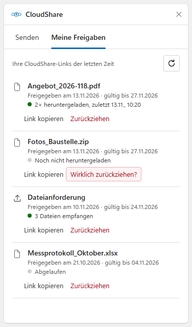

# CloudShare – hardened, large Outlook attachments as Nextcloud links

Outlook add-in (classic and new Outlook, Exchange Online) that sends large files as a password-protected Nextcloud
link instead of an attachment. Recipients get the password automatically in a second mail as a Vaultwarden Send.
How it works and how Entra ID, Nextcloud and Vaultwarden are set up: [docs/architecture.md](docs/architecture.md).

## What it looks like in Outlook


*Composing a mail: the ribbon button **CloudShare** opens the taskpane. Files are uploaded to the sender's
Nextcloud and inserted as a card – one row per file with a download button, expiry date and a footer filled from
the sender's Microsoft 365 profile (`MAIL_FOOTER`). The password follows automatically in a second mail after
sending. The taskpane offers a random or own password (or none for file links), an other address for the password, link validity and **Dateien von Empfängern erhalten** (upload link).*



*Tab **Meine Freigaben**: the user's CloudShare links with download status ("2× heruntergeladen"), received files
for upload links, expired links, **Link kopieren** and **Zurückziehen** (with confirmation).*

*The images show example data ("Max Mustermann", example.com). They are rendered from
[docs/mockups](docs/mockups) with the real taskpane styles and icon:*
```powershell
& "C:\Program Files (x86)\Microsoft\Edge\Application\msedge.exe" --headless=new --hide-scrollbars `
  --window-size=1440,1010 --screenshot="docs\images\outlook-compose.png" "file:///<repo>/docs/mockups/compose-send.html"
& "C:\Program Files (x86)\Microsoft\Edge\Application\msedge.exe" --headless=new --hide-scrollbars `
  --window-size=376,640 --screenshot="docs\images\outlook-my-shares.png" "file:///<repo>/docs/mockups/shares-pane.html"
```

<br clear="right">

## Requirements

- Microsoft 365 / Exchange Online, classic Outlook (Windows) or new Outlook / Outlook on the web
- Nextcloud with public link sharing (any login method – users connect once via Login Flow v2)
- Vaultwarden with Sends enabled and a service account for CloudShare
- A Docker host with Docker Compose ≥ 2.20, a public DNS name and ports 80/443 reachable from the internet

## Deployment

The stack is self-contained: its own Caddy terminates TLS (Let's Encrypt) and forwards to CloudShare.
Nextcloud, Vaultwarden and Microsoft are reached through their public addresses. The examples use
`cloudshare.example.com` (CloudShare), `cloud.example.com` (Nextcloud) and `vault.example.com` (Vaultwarden).

```
Outlook add-in ─HTTPS─► caddy (ports 80/443, Let's Encrypt) ─internal─► cloudshare:3000
cloudshare ─egress─► Entra ID/Graph (password mail) · Nextcloud (upload, links) · Vaultwarden (Send)
```

## Layout `/opt/cloudshare` (Git clone)

| Path | Content |
|---|---|
| `docker-compose.yml` | stub for Portainer/Dockhand (`include` + variables) |
| `compose.yml` | Caddy and CloudShare containers |
| `caddy/Caddyfile` | site configuration; host name from `CLOUDSHARE_HOST` |
| `env/versions.env` | `CLOUDSHARE_HOST`, `CLOUDSHARE_VERSION` (`latest`), `CADDY_VERSION` |
| `env/cloudshare.env` | Entra ID, Nextcloud, Vaultwarden service account, `CREDENTIAL_KEY` – **secrets** |
| volume `cloudshare_data` | users' encrypted Nextcloud app passwords – **back up** |
| volume `cloudshare_caddy_data` | certificates |
| `setup.sh` | new installation: asks for all settings and writes `env/` |

GitHub builds the image `ghcr.io/mrprohl/cloudshare` on every push to `main` (`.github/workflows/image.yml`) –
nothing is built on the server. `env/` is not in Git.

Hardening: both containers read-only, `cap_drop: ALL` (Caddy only gets `NET_BIND_SERVICE`), `no-new-privileges`,
limits, log rotation; CloudShare runs as user 1000 and publishes no ports. Networks: `internal` (Caddy ↔ CloudShare,
no outbound access), `edge` (Caddy, published ports) and `egress` (CloudShare, outbound). `bw serve` listens on
127.0.0.1 inside the container only. The Caddyfile sets no `X-Frame-Options`, because new Outlook and Outlook on
the web show the taskpane in an iframe.

## New installation

### 1. Clone and set up
```bash
git clone https://github.com/mrprohl/CloudShare.git /opt/cloudshare
cd /opt/cloudshare && ./setup.sh     # asks for address, Entra ID, Nextcloud, Vaultwarden
grep CREDENTIAL_KEY env/cloudshare.env   # store in your password manager
```

### 2. DNS and deployment
- DNS: `cloudshare.example.com` → public address of the Docker host (A/AAAA or CNAME); open ports 80 and 443
  (TCP, 443 also UDP for HTTP/3). Caddy fetches the certificate on the first start.
- Portainer/Dockhand: stack "cloudshare" → contents of `/opt/cloudshare/docker-compose.yml` → Deploy
  (or `cd /opt/cloudshare && docker compose up -d`).
- Vaultwarden: `SENDS_ALLOWED=true`.
- Microsoft 365 admin center → *Integrated apps* → *Upload custom apps* → manifest URL
  `https://cloudshare.example.com/manifest.xml` (first only for your own account). Alternative with a clear error
  message: Exchange Online PowerShell,
  `New-App -OrganizationApp -Url https://cloudshare.example.com/manifest.xml -ProvidedTo Everyone -DefaultStateForUser Enabled`.

Behind an existing reverse proxy instead: remove the `caddy` service and its `ports:` from `compose.yml`, put
`cloudshare` into the proxy's network and forward the host name to `cloudshare:3000` with the settings from
`caddy/Caddyfile` (request body ≥ 12 MB, no `X-Frame-Options`).

## Tests

Backend and add-in have automated tests (vitest) in `server/test/` and `addin/test/`:

- **API** (`api.test.ts`, via `fastify.inject`): login required, users cannot touch each other's uploads, jobs or
  links, only CloudShare links can be revoked, file names/sizes/chunk numbers are validated, limits are enforced.
- **Outlook event handlers** (`commands.test.ts`, Office.js mock): `enforce`/`suggest`, arming before the
  prompt, Mailbox 1.12 vs 1.14, shared mailboxes, server unreachable (cached configuration), info bar.
- Password rules and generator, encryption, Graph, Nextcloud client, password-job flow, footer template, mail card.

Network calls are mocked.

**CI pipeline** (`.github/workflows/image.yml`, on every push to `main` and on `v*` tags):

| Stage | Checks |
|---|---|
| test | type check and tests for both packages · `npm audit` (runtime dependencies, high/critical) · manifest validation (`npm run validate:manifest`) · ShellCheck · deployment files: `setup.sh` run with dummy answers (file modes, generated host/key), `docker compose config` for the stub and `compose.yml`, `caddy validate` |
| ui | taskpane in Chromium (Playwright, `addin/e2e`), Office.js and API mocked: connect flow, preselection of large attachments, chunked upload and inserted card (HTML and plain text), own password rules, links without password, upload link, revoked connection, "Meine Freigaben" with revoke confirmation and inserting a link again, dark theme, 320 px width, **accessibility** (axe, WCAG 2 A/AA, no serious/critical findings); report with screenshots as artifact `ui-test-report` |
| build | image build · Trivy scan (critical/high with an available fix) · **stack smoke test**: the new image and Caddy are started with `compose.yml` and dummy settings (Bitwarden CLI replaced by a mock, `ci/fake-bw`) and tested from outside – TLS and HTTP→HTTPS redirect, security headers (no `X-Frame-Options`), add-in files with replaced placeholders, `/api/config`, 401 without login, 413 above 12 MB, read-only/user/capabilities/ports/internal network |
| | **upgrade test**: the currently published image writes Nextcloud connections and password jobs into the data volume, the new image must read them unchanged and start on them (no reconnect after an update) |
| | **load test** (k6, `ci/load/upload.js`): 10 users upload 2 × 45 MiB each in parallel through Caddy, Nextcloud and Microsoft token keys mocked (`ci/mocks`) – no failed request, p95 < 3 s per chunk, every byte arrives, memory below 80 % of `mem_limit`, no restart |
| push | only if everything passed: `ghcr.io/mrprohl/cloudshare` (`latest`, `sha-<commit>`, version tags) |

Pull requests (e.g. from Dependabot) run the same checks including the smoke test, but publish nothing.

**Security services** of the public repository: **Dependabot** (`.github/dependabot.yml`: weekly update PRs for npm
in `server/` and `addin/`, GitHub Actions and the Node base image – minor/patch grouped, no Node major; plus
alerts and automatic security-fix PRs), **CodeQL** code scanning (default setup, extended queries for
JavaScript/TypeScript and Actions) and **secret scanning with push protection**. Findings: repository →
*Security*.

Deployment stays manual (re-pull, see *Updating*). Locally:
```bash
cd server && npm install && npm test
cd addin && npm install && npm test
ci/stack.sh validate        # test machine with Docker only – links the repo to /opt/cloudshare, writes dummy env/
ci/stack.sh smoke ghcr.io/mrprohl/cloudshare latest
ci/stack.sh upgrade ghcr.io/mrprohl/cloudshare:sha-<older> ghcr.io/mrprohl/cloudshare latest
ci/stack.sh load ghcr.io/mrprohl/cloudshare latest
cd addin && npx playwright install chromium && npm run test:ui
```

## Updating

- **Application and Caddy:** stack "cloudshare" → "Update the stack" with **re-pull**. To pin a state:
  `CLOUDSHARE_VERSION=sha-<commit>` (or `CADDY_VERSION`) in `env/versions.env`.
- **compose.yml / Caddyfile from the repository:** `cd /opt/cloudshare && git pull`, then update the stack; after a
  Caddyfile change alone `docker exec cloudshare-caddy caddy reload --config /etc/caddy/Caddyfile` is enough.
- **Settings:** edit `env/cloudshare.env` → update the stack.

## Checks

```bash
docker ps --filter name=cloudshare                         # cloudshare "healthy", cloudshare-caddy "Up"
docker logs cloudshare 2>&1 | grep -i vault                # "Vaultwarden vault unlocked"
docker logs cloudshare-caddy 2>&1 | grep -i certificate    # "certificate obtained successfully"
docker exec cloudshare wget -qO- http://127.0.0.1:3000/api/config
curl -s https://cloudshare.example.com/api/config         # from outside: same JSON
```
Note for Nextcloud: all requests from CloudShare arrive from the server's public address. If Nextcloud's
brute-force protection ever throttles them, allow that address in the "Brute-force settings" app.

**Sending hangs in a client** ("CloudShare dauert länger als erwartet"): set `CLIENT_TRACE=true` in
`env/cloudshare.env`, recreate the stack, send once and read the steps of the send check:
```bash
docker logs --since 5m cloudshare 2>&1 | grep 'Smart Alert trace' | grep -oE '"trace":"[^"]+"|"step":"[^"]+"|"ms":[0-9]+|"host":"[^"]+"|"origin":"[^"]+"|"detail":"[^"]*"'
```
The last step shown is where it stops. Switch it off again afterwards (`CLIENT_TRACE` removed, stack recreated).
